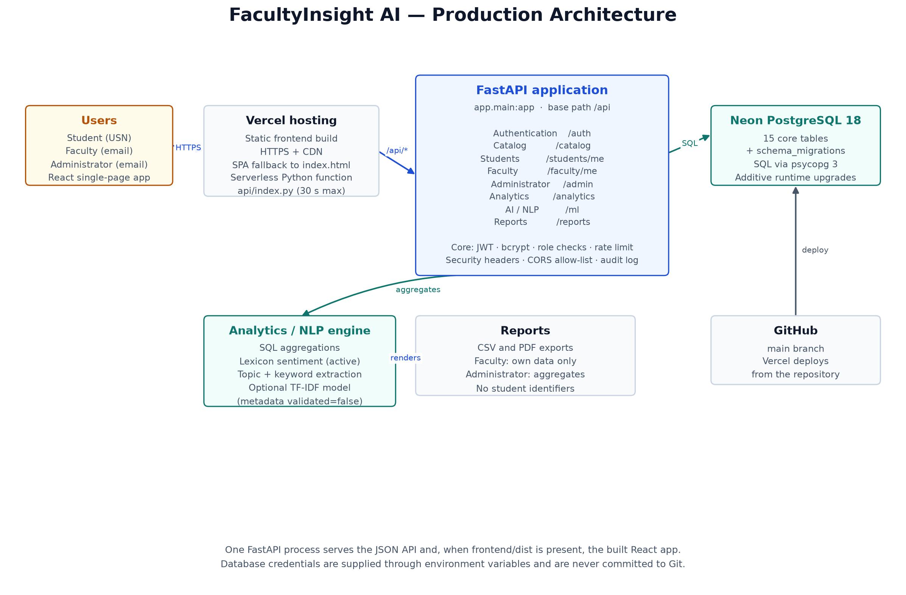

# FacultyInsight AI

**AI-assisted faculty feedback management and teaching-performance analysis for a CSE department.**

FacultyInsight AI is a full-stack web application that collects **anonymous student feedback**, enforces a complete feedback lifecycle, and turns real rating data into **transparent, explainable analytics** for faculty and administrators.

It is a working system — PostgreSQL schema, FastAPI backend, React frontend, automated tests, CSV/PDF reports, audit logging and a production deployment — not a mock-up.

<p>
  <a href="https://faculty-feedback-system-blush.vercel.app"><strong>Live demo</strong></a> ·
  <a href="#documentation-index"><strong>Documentation</strong></a> ·
  <a href="#quick-start-windows"><strong>Quick start</strong></a>
</p>

---

## Table of contents

1. [Problem statement](#problem-statement)
2. [Objectives](#objectives)
3. [Features](#features)
4. [The three roles](#the-three-roles)
5. [Technology stack](#technology-stack)
6. [Architecture](#architecture)
7. [Screenshots and diagrams](#screenshots-and-diagrams)
8. [Quick start (Windows)](#quick-start-windows)
9. [Environment variables](#environment-variables)
10. [Database setup](#database-setup)
11. [Running the app](#running-the-app)
12. [Testing](#testing)
13. [Deployment](#deployment)
14. [Project structure](#project-structure)
15. [Security and privacy](#security-and-privacy)
16. [Known limitations](#known-limitations)
17. [Future work](#future-work)
18. [Documentation index](#documentation-index)

---

## Problem statement

Collecting teaching feedback in a college department is usually manual. Paper forms and spreadsheets create recurring problems:

- Students are not anonymous, so feedback is biased or withheld.
- Results are not aggregated; someone must total hundreds of forms.
- Faculty cannot see their own data privately or promptly.
- There is no audit trail of administrative changes.
- A subject, the faculty who teaches it and the feedback for that exact offering are not linked.
- "Insights" are impressions rather than numbers and quoted themes.

FacultyInsight AI addresses each problem with a structured data model, server-enforced rules, role-based access and explainable analytics.

## Objectives

1. Let students submit **one** structured feedback form per subject offering.
2. Keep feedback **anonymous** to faculty and administrators while preventing duplicates.
3. Give faculty a **private** view of only their own subjects, ratings and comments.
4. Give administrators a **department-wide** view for quality review.
5. Produce **transparent analytics**: averages, distributions, question scores, trends and themes.
6. Provide **CSV and PDF exports** for offline reporting.
7. Enforce **RBAC** and record sensitive actions in an **audit log**.
8. Run on free/entry-level infrastructure (Vercel + Neon).

## Features

### Student
- Register with USN, name and department; sign in with USN + password.
- Dashboard filtered by academic year and semester.
- Clear per-offering status: **submitted**, **pending** or **closed**.
- Feedback form: every active question rated 1–5, plus a 10–1000 character comment.
- Edit a submission only while the feedback period is open.
- Anonymity enforced by query design, not just policy.

### Faculty
- Self-registration with administrator approval.
- Choose the subjects they teach for a year and semester.
- Request a subject missing from the catalog.
- Private dashboard: averages, distribution, question scores, trends, sentiment, insights.
- Anonymised student comments.
- Completion tracker for their own subjects, using the administrator-maintained class roster.
- Pending-student PDF and a prepared WhatsApp reminder (shares aggregate counts only).
- Download own CSV/PDF report.
- Change own password.

### Administrator
- First-run setup at `/setup`.
- Department dashboard: counts, performance by year, responses by semester, faculty comparison, question averages, improvement opportunities.
- Manage departments, academic years, subjects, questions and feedback periods.
- Create and approve/reject/deactivate faculty.
- Create, edit and deactivate students.
- Maintain verified class rosters per subject, academic year and semester.
- Review subject requests.
- Manage other administrators.
- Audit log.
- Department CSV/PDF reports.

### Platform
- JWT authentication (HS256, 30-minute default).
- bcrypt password hashing and strength rules.
- Login rate limiting.
- Security headers, CORS allow-list, generic error responses.
- Additive, idempotent database migrations that never drop data.
- Installable PWA shell with an offline page and explicit update prompt (not a native app).
- Responsive navy/teal interface with keyboard focus states and reduced-motion support.
- Automated backend and frontend tests.

## The three roles

| Role | Identifier | Can do | Cannot do |
|------|-----------|--------|-----------|
| **Student** | USN | View visible offerings, submit/edit own feedback | See other students' data, change offerings |
| **Faculty** | Email | Manage own subject selections, view own analytics/comments, export own report | See other faculty's data, assign subjects to others |
| **Administrator** | Email | Manage catalog/accounts, approve requests, view department analytics, audit log | Assign teaching loads, see student identities in feedback |

A faculty account must be `approved` before it can sign in or be selected for an offering.

## Technology stack

| Layer | Technologies |
|-------|--------------|
| Frontend | React 18.3, TypeScript 5.9, Vite 6, Tailwind CSS 3.4, React Router 6.28, Recharts 2.15, Zod 3.24 |
| Backend | Python 3.12, FastAPI 0.143, Starlette 1.6, Uvicorn 0.54, Pydantic 2.14 |
| Data | PostgreSQL 18, psycopg 3.3.6 |
| Security | bcrypt 5.0, PyJWT 2.15 |
| Reporting / ML | ReportLab 5.1, scikit-learn 1.9, pandas 3.0 |
| Hosting | Vercel (SPA + Python function), Neon PostgreSQL |
| Local containers | Docker Compose, Nginx 1.27 |

Exact versions and rationale: [03 — Technology Stack](docs/03-technology-stack.md).

## Architecture



```text
React SPA (Vercel CDN)
        │  HTTPS / JSON · Bearer JWT
        ▼
FastAPI  (/api)  ──►  Analytics / NLP engine
        │                     │
        │  SQL (psycopg 3)    │
        ▼                     ▼
PostgreSQL 18 (Neon) ◄────────┘
```

- One FastAPI app serves the JSON API and, when `frontend/dist` is present, the built SPA.
- `api/index.py` is the Vercel serverless entry point; it imports `app.main:app` without changing application code.
- Analytics run as SQL inside the API process; there is no separate analytics service.
- Database changes are additive and applied at runtime with an advisory lock.

Full detail: [02 — System Architecture](docs/02-system-architecture.md).

## Screenshots and diagrams

No screenshots are bundled with the repository. The three generated diagrams are the visual documentation:

| Diagram | File |
|---------|------|
| Production architecture | [`docs/images/architecture-diagram.png`](docs/images/architecture-diagram.png) |
| Database ER diagram | [`docs/images/database-er-diagram.png`](docs/images/database-er-diagram.png) |
| Feedback lifecycle | [`docs/images/workflow-diagram.png`](docs/images/workflow-diagram.png) |

To capture screenshots for a submission, run the app locally and save images under `docs/images/`, then link them here.

---

## Quick start (Windows)

**Prerequisites:** Python 3.12, Node.js 20, PostgreSQL 18, Git.

```powershell
# 1. Clone
cd E:\samruddhi
git clone https://github.com/guravsamruddhi2006-maker/FacultyFeedbackAnalysis.git faculty-feedback-system
cd faculty-feedback-system

# 2. Python environment
python -m venv .venv
.\.venv\Scripts\Activate.ps1
pip install -r backend\requirements.txt

# 3. Database
psql -U postgres -c "CREATE DATABASE faculty_feedback;"
psql -U postgres -d faculty_feedback -f database\schema.sql
psql -U postgres -d faculty_feedback -f database\seed.sql

# 4. Configuration
Copy-Item .env.example .env
# edit .env: set DB_PASSWORD and a strong JWT_SECRET_KEY

# 5. Backend (terminal 1)
cd backend
uvicorn app.main:app --reload --port 8000

# 6. Frontend (terminal 2, from the repository root)
cd frontend
npm ci
npm run dev
```

Open <http://localhost:5173> and create the first administrator at <http://localhost:5173/setup>.

> `seed.sql` creates **no user accounts** — only departments, semesters, academic years, questions and subjects.

Detailed guide with troubleshooting: [16 — Installation on Windows](docs/16-installation-on-windows.md).

## Environment variables

| Variable | Required | Default | Purpose |
|----------|----------|---------|---------|
| `DATABASE_URL` | Production | — | Full PostgreSQL connection string; overrides `DB_*` |
| `DB_HOST` | Local | `localhost` | Database host |
| `DB_PORT` | Local | `5432` | Database port |
| `DB_NAME` | Local | `faculty_feedback` | Database name |
| `DB_USER` | Local | `postgres` | Database user |
| `DB_PASSWORD` | Local | — | Database password |
| `JWT_SECRET_KEY` | Yes | — | JWT signing secret (≥ 16 chars; 32+ recommended) |
| `ACCESS_TOKEN_MINUTES` | No | `30` | Token lifetime |
| `APP_ENV` | No | `development` | `production` disables `/docs` and enforces HSTS |
| `CORS_ORIGINS` | No | localhost origins | Comma-separated allowed origins |
| `LOGIN_RATE_LIMIT` | No | `12` | Login attempts per window |
| `LOGIN_RATE_WINDOW_SECONDS` | No | `300` | Rate-limit window |

Notes:

- The backend loads `.env` from the repository root and `backend/.env`; root values win.
- `API_PREFIX` in `backend/.env.example` is **not read** — the prefix is hardcoded to `/api`.
- Never commit `.env` files or real secrets.

Generate a secret:

```powershell
python -c "import secrets; print(secrets.token_urlsafe(48))"
```

## Database setup

- **Schema:** `database/schema.sql` — 16 core tables + `schema_migrations`.
- **Seed:** `database/seed.sql` — 1 department, 8 semesters, 4 academic years, 5 questions, 54 subjects (none for semester 8), **no users**.
- **Migrations:** `database/migrations/001`–`004`, all additive and idempotent.
- **Runtime upgrade:** `backend/app/schema.py` applies missing changes on first use with an advisory lock.

Full schema and relationships: [05 — Database Schema](docs/05-database-schema.md) · [06 — Migrations and Seeding](docs/06-migrations-and-seeding.md).

## Running the app

| Service | URL |
|---------|-----|
| Frontend (dev) | <http://localhost:5173> |
| Backend | <http://localhost:8000> |
| Health | <http://localhost:8000/health> |
| DB health | <http://localhost:8000/health/db> |
| API docs (dev only) | <http://localhost:8000/docs> |

### Docker Compose

```powershell
docker compose up --build
```

Frontend on <http://localhost:5173>, backend on <http://localhost:8000>. Harden the default credentials before exposing it.

## Testing

```powershell
# Backend (force an explicit local URL; PowerShell removes a variable set to "")
$env:DATABASE_URL="postgresql://postgres:<local-password>@localhost:5432/faculty_feedback"
$env:TEST_DB_NAME="faculty_feedback_test"
python -m pytest backend\tests -q

# Frontend
cd frontend
npm test -- --reporter=dot

# Type check + production build
npm run build
```

Last local results:

| Check | Result |
|-------|--------|
| Backend pytest | **86 passed** |
| Frontend Vitest | **21 passed** (6 files) |
| Playwright PWA/responsive spec | **8 passed** |
| TypeScript + Vite build | **Passed** |

See [18 — Testing](docs/18-testing.md) for the test database setup and the `DATABASE_URL` caveat.

## Deployment

Production runs on **Vercel + Neon PostgreSQL**:

- `vercel.json` sets `framework: fastapi` and a 30-second function limit.
- `api/index.py` exposes `app.main:app`.
- Set `DATABASE_URL`, `JWT_SECRET_KEY`, `APP_ENV=production` and `CORS_ORIGINS` in Vercel.
- Load `schema.sql` and `seed.sql` into Neon, then create the first admin at `/setup`.
- `/docs` and `/openapi.json` are disabled in production.

Live URL: <https://faculty-feedback-system-blush.vercel.app>

Full guide: [17 — Deployment](docs/17-deployment.md).

## Project structure

```text
faculty-feedback-system/
├── backend/        FastAPI app, services, schemas, tests
├── frontend/       React + TypeScript SPA
├── database/       schema.sql, seed.sql, migrations
├── ml/             Optional sentiment training assets
├── docs/           23-document set + diagrams
├── api/index.py    Vercel serverless entry
├── docker-compose.yml
└── vercel.json
```

Detailed map: [04 — Project Structure](docs/04-project-structure.md).

## Security and privacy

- bcrypt password hashing; no plaintext storage.
- Short-lived HS256 JWTs; account state re-checked on every request.
- Server-side role guards on every protected route.
- Student IDs never returned by faculty, analytics or report queries.
- Parameterised SQL throughout.
- CORS allow-list, security headers, HSTS in production.
- Login rate limiting (per process — see limitations).
- Audit log for sensitive actions.
- Generic error bodies; details only in server logs.

Full review: [15 — Security and Privacy](docs/15-security-and-privacy.md).

## Known limitations

- Single-department design; no multi-tenancy.
- Sentiment is a transparent **lexicon baseline** (`lexicon-v1`); the TF-IDF model is **not active** because its metadata says `"validated": false`.
- No email/SMS notifications, chat or native mobile app. The web app is installable as a PWA, but there is no offline data entry: feedback, rosters and reports require a live connection.
- Login rate limiting is per process, not global.
- No token revocation list; logout is client-side.
- No CI pipeline; tests run manually.
- Reports are generated in memory and can hit the 30-second serverless limit.
- Very small classes can make a distinctive comment recognisable despite anonymity controls.

Full list: [20 — Known Limitations](docs/20-known-limitations.md).

## Future work

Prioritised ideas include CI and dependency scanning, CSP and global rate limiting, admin password reset, bulk student import, confidence intervals, minimum-response suppression for comments, email notifications, and — only with real consented data — a validated sentiment model.

Roadmap: [22 — Future Enhancements](docs/22-future-enhancements.md).

---

## Documentation index

| # | Document | Contents |
|---|----------|----------|
| 01 | [Project Overview](docs/01-project-overview.md) | Problem, objectives, features, roles, status |
| 02 | [System Architecture](docs/02-system-architecture.md) | Components, request flow, deployment topology |
| 03 | [Technology Stack](docs/03-technology-stack.md) | Exact versions and rationale |
| 04 | [Project Structure](docs/04-project-structure.md) | Repository map |
| 05 | [Database Schema](docs/05-database-schema.md) | Every table, column, index, relationship |
| 06 | [Migrations and Seeding](docs/06-migrations-and-seeding.md) | Setup, upgrades, runtime schema, rollback policy |
| 07 | [API Reference](docs/07-api-reference.md) | All endpoints with auth and examples |
| 08 | [Authentication and Authorization](docs/08-authentication-and-authorization.md) | JWT, RBAC, rate limiting, recovery |
| 09 | [Student Guide](docs/09-student-guide.md) | Registration, feedback, anonymity |
| 10 | [Faculty Guide](docs/10-faculty-guide.md) | Selections, analytics, comments, reports |
| 11 | [Administrator Guide](docs/11-administrator-guide.md) | Setup, catalog, approvals, audit |
| 12 | [Subject Selection and Requests](docs/12-subject-selection-and-requests.md) | Teaching-load rules end to end |
| 13 | [Feedback Lifecycle](docs/13-feedback-lifecycle.md) | Submission, validation, editing, aggregation |
| 14 | [Analytics and AI](docs/14-analytics-and-ai.md) | Metrics, thresholds, lexicon engine, ML honesty |
| 15 | [Security and Privacy](docs/15-security-and-privacy.md) | Controls, data minimisation, hardening |
| 16 | [Installation on Windows](docs/16-installation-on-windows.md) | Step-by-step local setup |
| 17 | [Deployment](docs/17-deployment.md) | Vercel, Neon, Docker, operations |
| 18 | [Testing](docs/18-testing.md) | Suites, commands, results, coverage |
| 19 | [Troubleshooting](docs/19-troubleshooting.md) | Symptom → cause → fix |
| 20 | [Known Limitations](docs/20-known-limitations.md) | Honest scope boundaries |
| 21 | [Glossary](docs/21-glossary.md) | Domain, technical and AI terms |
| 22 | [Future Enhancements](docs/22-future-enhancements.md) | Prioritised roadmap |
| 23 | [PWA and Completion Tracking](docs/23-pwa-and-completion-tracking.md) | PWA, responsive UI, rosters, completion tracker, PDF, WhatsApp, verification |

---

## Contributing

1. Read the relevant document in `docs/` before changing behaviour.
2. Keep migrations additive and reversible.
3. Add or update tests; do not weaken existing ones.
4. Never commit secrets, dumps or personal data.
5. Update the documentation alongside the code.

## License

No license file is included in this repository. Treat it as coursework/portfolio code unless a license is added by the owner.

## Acknowledgements

Built with FastAPI, React, PostgreSQL, Vite, Tailwind CSS, Recharts, ReportLab and scikit-learn. Hosted on Vercel with Neon PostgreSQL.
