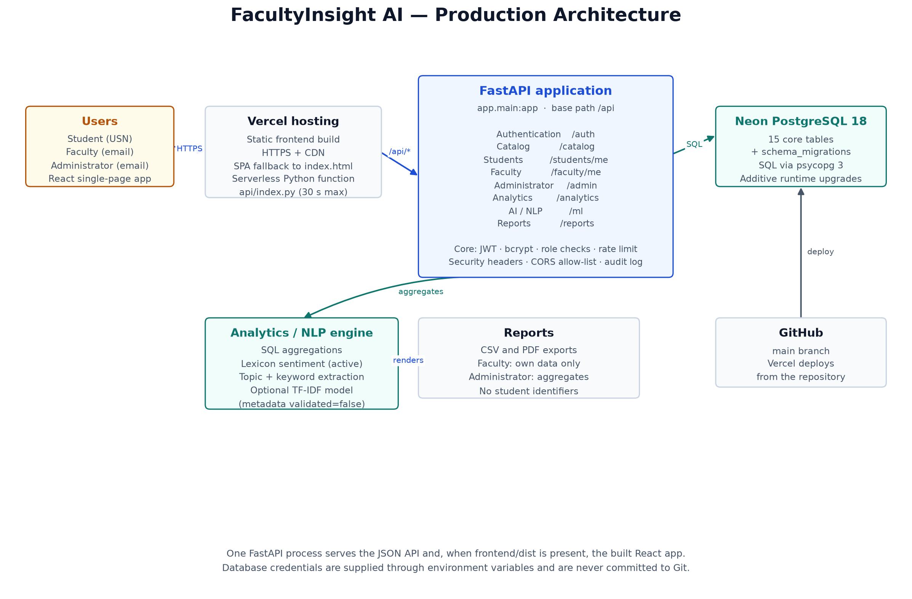

# 02 — System Architecture

> **FacultyInsight AI** · Documentation set · [Back to index](../README.md#documentation-index)

## 2.1 Architecture at a glance



*Figure 1 — Production architecture. The same FastAPI process serves the JSON API and, when `frontend/dist` exists, the built React app.*

The system is a conventional three-tier web application:

| Tier | Technology | Responsibility |
|------|-----------|----------------|
| Presentation | React 18 SPA built with Vite | Screens, forms, charts, client-side routing |
| Application | FastAPI on Python 3.12 | REST API, validation, auth, analytics, reports |
| Data | PostgreSQL 18 (Neon in production) | Persistent storage and aggregation |

There is no message queue, cache server or separate analytics service. Analytics run as SQL queries inside the API process. This keeps the deployment small and free-tier friendly.

## 2.2 Component responsibilities

### Frontend (`frontend/`)
- Single-page app with `BrowserRouter` routes.
- Stores the JWT and a cached user object in `localStorage` under `facultyinsight.token` and `facultyinsight.user`.
- Calls the API through a small wrapper in `frontend/src/lib/api.ts`, which attaches the bearer token and normalises errors.
- Guards routes by role with `ProtectedRoute`.
- Uses `recharts` for charts and Tailwind CSS for styling.

### Backend (`backend/app/`)
| Module | Responsibility |
|--------|----------------|
| `main.py` | App factory, middleware, exception handlers, router registration, health checks, optional SPA serving |
| `core/config.py` | Environment-driven `Settings` |
| `core/security.py` | bcrypt hashing, JWT encode/decode, password rules, USN/email normalisation |
| `core/deps.py` | Bearer extraction, role guards, login rate limiter, client IP helper |
| `db.py` | Connection helper and FastAPI dependency |
| `schema.py` | Idempotent runtime schema upgrade + data corrections |
| `api/` | One router per domain: auth, catalog, students, faculty, admin, analytics, ml, reports |
| `analytics/` | Aggregation queries and NLP text utilities |
| `services/` | Insights, audit logging, report building |
| `schemas/` | Pydantic request/response models |
| `recover_admin.py` | Operator-only admin recovery CLI |
| `scripts/` | Operational scripts (production password change) |

### Database (`database/`)
- `schema.sql` — canonical schema, safe on an empty database.
- `seed.sql` — reference data only (departments, semesters, academic years, questions, subjects). **No user accounts.**
- `migrations/` — additive upgrades for legacy databases.
- `backups/` — local dumps, ignored by Git.

## 2.3 Request flow

A typical authenticated request:

```text
1. Browser sends  GET /api/faculty/me/dashboard
                  Authorization: Bearer <JWT>
2. CORS middleware checks the origin against the allow-list.
3. SecurityHeadersMiddleware adds headers and a request ID.
4. get_current_user decodes the JWT, verifies the signature and expiry,
   then re-reads the account row to confirm it still exists and is active.
5. The route's role guard (faculty_required) checks role == "faculty".
6. The route runs parameterised SQL and analytics helpers.
7. FastAPI serialises the response to JSON.
8. Middleware logs method, path, status and duration.
```

Every write that matters (account changes, catalog changes, approvals, feedback actions) calls `write_audit`, which inserts a row into `audit_logs`.

## 2.4 Runtime schema upgrades

Production database credentials are managed by the hosting platform, so the SQL migration files are also applied at runtime.

`backend/app/schema.py` runs on the first database-backed request of each process. It:

- takes a **transaction-scoped advisory lock** so concurrent cold starts cannot race;
- creates only missing tables, columns and indexes;
- records applied corrections in `schema_migrations`;
- never drops or truncates a table, column or row;
- never assigns subjects to faculty automatically;
- deactivates rows that an earlier migration backfilled, while keeping offerings and feedback intact.

See [06 — Migrations and Seeding](./06-migrations-and-seeding.md) for the exact steps.

## 2.5 Authentication and session model

- The API is **stateless**: no server-side session store.
- A successful login returns a signed JWT plus user details.
- The token payload contains `sub` (the account id), `role`, `iat` and `exp`.
- Default lifetime is **30 minutes**, configurable with `ACCESS_TOKEN_MINUTES`.
- The frontend attaches the token to every API call.
- On a `401`, the frontend clears the stored token and redirects to `/login`.

There is no refresh token. When the token expires, the user signs in again. See [08 — Authentication and Authorization](./08-authentication-and-authorization.md).

## 2.6 Deployment topology

### Production (Vercel + Neon)

```text
GitHub main branch
        │  push triggers build
        ▼
Vercel
 ├── builds frontend/dist  (Vite)
 ├── deploys api/index.py  (Python serverless function, 30 s max)
 └── routes /api/* to the function, everything else to the SPA
        │
        ▼
Neon PostgreSQL 18
```

- `api/index.py` adds `backend/` to `sys.path` and imports `app.main:app`. Application code is unchanged.
- `vercel.json` sets `framework: fastapi` and the function's `maxDuration` to 30 seconds.
- When `frontend/dist` is present, FastAPI serves it with SPA fallback, so deep links such as `/faculty/subjects` work after a refresh.
- When `APP_ENV=production`, `/docs`, `/redoc` and `/openapi.json` are disabled.

### Local development

```text
Vite dev server :5173  ──proxy /api──►  Uvicorn :8000  ──►  local PostgreSQL :5432
```

`frontend/vite.config.ts` proxies `/api` to `http://localhost:8000` (override with `VITE_PROXY_TARGET`).

### Docker Compose

`docker-compose.yml` runs three services: PostgreSQL, the backend container (Uvicorn) and the frontend container (Nginx). Nginx serves the built SPA and proxies `/api/` to the backend container. See [17 — Deployment](./17-deployment.md).

## 2.7 Design decisions and trade-offs

| Decision | Why | Trade-off |
|----------|-----|-----------|
| Serverless API | No server to patch; free tier | 30 s request limit; cold starts |
| Stateless JWT | Simple horizontal scaling | No server-side logout/revocation list |
| SQL analytics in-process | Fewer moving parts | Heavy reports compete with API requests |
| Runtime additive migrations | Works when only the DB URL is available | Must stay strictly additive and idempotent |
| Lexicon sentiment | Transparent and explainable | Less accurate than a trained model |
| Single department | Matches the real use case | Not multi-tenant |
| File-based reports | No extra service | Large exports are bounded by memory |

## 2.8 Failure behaviour

| Failure | Behaviour |
|---------|-----------|
| Database unreachable | `503` with a friendly message; details only in server logs |
| Unhandled exception | `500` with a generic message; stack trace logged |
| Invalid request body | `422` with a field-level error list |
| Expired/invalid token | `401` with `WWW-Authenticate: Bearer` |
| Wrong role | `403` |
| Too many login attempts | `429` from the rate limiter |

## 2.9 Related documents

- [03 — Technology Stack](./03-technology-stack.md)
- [05 — Database Schema](./05-database-schema.md)
- [08 — Authentication and Authorization](./08-authentication-and-authorization.md)
- [17 — Deployment](./17-deployment.md)

---

**Next:** [03 — Technology Stack →](./03-technology-stack.md)
