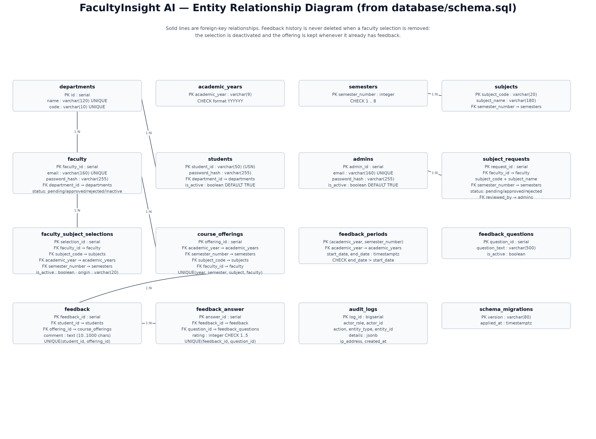

# 05 — Database Schema

> **FacultyInsight AI** · Documentation set · [Back to index](../README.md#documentation-index)

The canonical schema is `database/schema.sql`. It creates **16 core tables** plus one runtime bookkeeping table (`schema_migrations`). It is safe to run against an empty database.

*Figure 1 — Entity relationship diagram derived from `database/schema.sql`. Solid lines are foreign-key relationships.*

## 5.1 Table groups

| Group | Tables |
|-------|--------|
| Reference data | `departments`, `semesters`, `academic_years`, `subjects`, `feedback_questions` |
| Accounts | `faculty`, `students`, `admins` |
| Teaching load | `faculty_subject_selections`, `subject_requests`, `course_offerings` |
| Rosters | `student_enrollments` |
| Feedback | `feedback_periods`, `feedback`, `feedback_answer` |
| Operations | `audit_logs`, `schema_migrations` |

## 5.2 Reference tables

### `departments`

| Column | Type | Constraints |
|--------|------|-------------|
| `id` | `SERIAL` | Primary key |
| `name` | `VARCHAR(120)` | `NOT NULL`, `UNIQUE` |
| `code` | `VARCHAR(10)` | `NOT NULL`, `UNIQUE` |

Seeded with `Computer Science and Engineering` / `CSE`.

### `semesters`

| Column | Type | Constraints |
|--------|------|-------------|
| `semester_number` | `INTEGER` | Primary key; `CHECK BETWEEN 1 AND 8` |

### `academic_years`

| Column | Type | Constraints |
|--------|------|-------------|
| `academic_year` | `VARCHAR(9)` | Primary key; `CHECK ~ '^[0-9]{4}-[0-9]{2}$'` |

### `subjects`

| Column | Type | Constraints |
|--------|------|-------------|
| `subject_code` | `VARCHAR(20)` | Primary key |
| `subject_name` | `VARCHAR(180)` | `NOT NULL` |
| `semester_number` | `INTEGER` | `NOT NULL`, FK → `semesters`, `ON DELETE RESTRICT` |

### `feedback_questions`

| Column | Type | Constraints |
|--------|------|-------------|
| `question_id` | `SERIAL` | Primary key |
| `question_text` | `VARCHAR(500)` | `NOT NULL`, `CHECK length(trim(...)) >= 5` |
| `is_active` | `BOOLEAN` | `NOT NULL DEFAULT TRUE` |

Only active questions appear on the feedback form. Deactivating a question does not delete historical answers.

## 5.3 Accounts

### `faculty`

| Column | Type | Constraints |
|--------|------|-------------|
| `faculty_id` | `SERIAL` | Primary key |
| `name` | `VARCHAR(120)` | `NOT NULL` |
| `email` | `VARCHAR(160)` | `NOT NULL`, `UNIQUE` |
| `password_hash` | `VARCHAR(255)` | `NOT NULL` (bcrypt) |
| `department_id` | `INTEGER` | `NOT NULL`, FK → `departments`, `ON DELETE RESTRICT` |
| `status` | `VARCHAR(20)` | `NOT NULL DEFAULT 'pending'`; `CHECK IN ('pending','approved','rejected','inactive')` |
| `created_at` | `TIMESTAMPTZ` | `NOT NULL DEFAULT CURRENT_TIMESTAMP` |

Only `approved` faculty can be selected for offerings and can use the faculty portal meaningfully.

### `students`

| Column | Type | Constraints |
|--------|------|-------------|
| `student_id` | `VARCHAR(50)` | Primary key (USN); `CHECK ~ '^[A-Za-z0-9]{6,50}$'` |
| `name` | `VARCHAR(120)` | `NOT NULL` |
| `department_id` | `INTEGER` | `NOT NULL`, FK → `departments`, `ON DELETE RESTRICT` |
| `password_hash` | `VARCHAR(255)` | `NOT NULL` |
| `is_active` | `BOOLEAN` | `NOT NULL DEFAULT TRUE` |
| `created_at` | `TIMESTAMPTZ` | `NOT NULL DEFAULT CURRENT_TIMESTAMP` |

Deactivation is reversible; the row is never deleted by the admin UI.

### `admins`

| Column | Type | Constraints |
|--------|------|-------------|
| `admin_id` | `SERIAL` | Primary key |
| `name` | `VARCHAR(120)` | `NOT NULL` |
| `email` | `VARCHAR(160)` | `NOT NULL`, `UNIQUE` |
| `password_hash` | `VARCHAR(255)` | `NOT NULL` |
| `is_active` | `BOOLEAN` | `NOT NULL DEFAULT TRUE` |
| `created_at` | `TIMESTAMPTZ` | `NOT NULL DEFAULT CURRENT_TIMESTAMP` |

## 5.4 Teaching load

### `faculty_subject_selections`

A faculty member's own declaration that they teach a subject in a given year and semester.

| Column | Type | Constraints |
|--------|------|-------------|
| `selection_id` | `SERIAL` | Primary key |
| `faculty_id` | `INTEGER` | `NOT NULL`, FK → `faculty`, `ON DELETE CASCADE` |
| `subject_code` | `VARCHAR(20)` | `NOT NULL`, FK → `subjects`, `ON DELETE RESTRICT` |
| `academic_year` | `VARCHAR(9)` | `NOT NULL`, FK → `academic_years`, `ON DELETE RESTRICT` |
| `semester_number` | `INTEGER` | `NOT NULL`, FK → `semesters`, `ON DELETE RESTRICT` |
| `is_active` | `BOOLEAN` | `NOT NULL DEFAULT TRUE` |
| `origin` | `VARCHAR(20)` | `NOT NULL DEFAULT 'faculty'` |
| `created_at` | `TIMESTAMPTZ` | `NOT NULL DEFAULT CURRENT_TIMESTAMP` |
| `updated_at` | `TIMESTAMPTZ` | Nullable |

Unique on `(faculty_id, subject_code, academic_year, semester_number)`.

### `student_enrollments`

Administrator-maintained verified class roster. Only these rows count as eligible students for faculty completion tracking; registered students are never assumed to be enrolled.

| Column | Type | Constraints |
|--------|------|-------------|
| `enrollment_id` | `SERIAL` | Primary key |
| `student_id` | `VARCHAR(50)` | `NOT NULL`, FK → `students`, `ON DELETE CASCADE` |
| `subject_code` | `VARCHAR(20)` | `NOT NULL`, FK → `subjects`, `ON DELETE RESTRICT` |
| `academic_year` | `VARCHAR(9)` | `NOT NULL`, FK → `academic_years`, `ON DELETE RESTRICT` |
| `semester_number` | `INTEGER` | `NOT NULL`, FK → `semesters`, `ON DELETE RESTRICT` |
| `created_at` | `TIMESTAMPTZ` | `NOT NULL DEFAULT CURRENT_TIMESTAMP` |

Unique on `(student_id, subject_code, academic_year, semester_number)`. The row is a roster fact only: it holds no rating, comment, sentiment or feedback reference.

### `subject_requests`

A faculty request to add a subject that is missing from the catalog.

| Column | Type | Constraints |
|--------|------|-------------|
| `request_id` | `SERIAL` | Primary key |
| `faculty_id` | `INTEGER` | `NOT NULL`, FK → `faculty`, `ON DELETE CASCADE` |
| `subject_code` | `VARCHAR(20)` | `NOT NULL`, `CHECK length(trim(...)) >= 2` |
| `subject_name` | `VARCHAR(180)` | `NOT NULL`, `CHECK length(trim(...)) >= 3` |
| `semester_number` | `INTEGER` | `NOT NULL`, FK → `semesters` |
| `status` | `VARCHAR(20)` | `NOT NULL DEFAULT 'pending'`; `CHECK IN ('pending','approved','rejected')` |
| `admin_note` | `VARCHAR(500)` | Nullable |
| `reviewed_by` | `INTEGER` | Nullable, FK → `admins`, `ON DELETE SET NULL` |
| `reviewed_at` | `TIMESTAMPTZ` | Nullable |
| `created_at` | `TIMESTAMPTZ` | `NOT NULL DEFAULT CURRENT_TIMESTAMP` |

A partial unique index allows **one pending request per subject code** at a time.

### `course_offerings`

The join between a subject, an academic year, a semester and a faculty member. Feedback is attached to an offering, not directly to a subject.

| Column | Type | Constraints |
|--------|------|-------------|
| `offering_id` | `SERIAL` | Primary key |
| `academic_year` | `VARCHAR(9)` | `NOT NULL`, FK → `academic_years` |
| `semester_number` | `INTEGER` | `NOT NULL`, FK → `semesters` |
| `subject_code` | `VARCHAR(20)` | `NOT NULL`, FK → `subjects` |
| `faculty_id` | `INTEGER` | `NOT NULL`, FK → `faculty` |
| `created_at` | `TIMESTAMPTZ` | `NOT NULL DEFAULT CURRENT_TIMESTAMP` |
| — | — | `UNIQUE (academic_year, semester_number, subject_code, faculty_id)` |

Offerings are created automatically when a faculty member makes an active selection, and removed only when they are no longer needed and have no feedback.

## 5.5 Feedback

### `feedback_periods`

| Column | Type | Constraints |
|--------|------|-------------|
| `academic_year` | `VARCHAR(9)` | `NOT NULL`, FK → `academic_years`, `ON DELETE CASCADE` |
| `semester_number` | `INTEGER` | `NOT NULL`, FK → `semesters` |
| `start_date` | `TIMESTAMPTZ` | `NOT NULL` |
| `end_date` | `TIMESTAMPTZ` | `NOT NULL` |
| — | — | Primary key `(academic_year, semester_number)`; `CHECK end_date > start_date` |

A period applies to every offering in that year and semester. If no period exists, the offering is treated as closed.

### `feedback`

| Column | Type | Constraints |
|--------|------|-------------|
| `feedback_id` | `SERIAL` | Primary key |
| `student_id` | `VARCHAR(50)` | `NOT NULL`, FK → `students`, `ON DELETE CASCADE` |
| `offering_id` | `INTEGER` | `NOT NULL`, FK → `course_offerings`, `ON DELETE CASCADE` |
| `submitted_at` | `TIMESTAMPTZ` | `NOT NULL DEFAULT CURRENT_TIMESTAMP` |
| `updated_at` | `TIMESTAMPTZ` | Nullable |
| `comment` | `TEXT` | `NOT NULL`, `CHECK char_length BETWEEN 10 AND 1000` |
| — | — | `UNIQUE (student_id, offering_id)` |

`student_id` exists **only** to enforce one submission per offering. It is never returned by faculty or analytics endpoints.

### `feedback_answer`

| Column | Type | Constraints |
|--------|------|-------------|
| `answer_id` | `SERIAL` | Primary key |
| `feedback_id` | `INTEGER` | `NOT NULL`, FK → `feedback`, `ON DELETE CASCADE` |
| `question_id` | `INTEGER` | `NOT NULL`, FK → `feedback_questions`, `ON DELETE RESTRICT` |
| `rating` | `INTEGER` | `NOT NULL`, `CHECK BETWEEN 1 AND 5` |
| — | — | `UNIQUE (feedback_id, question_id)` |

## 5.6 Operations

### `audit_logs`

| Column | Type | Constraints |
|--------|------|-------------|
| `log_id` | `BIGSERIAL` | Primary key |
| `actor_role` | `VARCHAR(20)` | `NOT NULL` |
| `actor_id` | `VARCHAR(50)` | `NOT NULL` |
| `action` | `VARCHAR(80)` | `NOT NULL` |
| `entity_type` | `VARCHAR(80)` | Nullable |
| `entity_id` | `VARCHAR(80)` | Nullable |
| `details` | `JSONB` | `NOT NULL DEFAULT '{}'` |
| `ip_address` | `VARCHAR(64)` | Nullable |
| `created_at` | `TIMESTAMPTZ` | `NOT NULL DEFAULT CURRENT_TIMESTAMP` |

### `schema_migrations` (runtime)

Created by `backend/app/schema.py` (and migration 003) when runtime corrections run.

| Column | Type | Constraints |
|--------|------|-------------|
| `version` | `VARCHAR(80)` | Primary key |
| `applied_at` | `TIMESTAMPTZ` | `NOT NULL DEFAULT CURRENT_TIMESTAMP` |

## 5.7 Indexes

| Index | Table | Columns |
|-------|-------|---------|
| `idx_faculty_status` | `faculty` | `status` |
| `idx_students_active` | `students` | `is_active` |
| `idx_course_offerings_faculty` | `course_offerings` | `faculty_id` |
| `idx_course_offerings_scope` | `course_offerings` | `academic_year, semester_number, subject_code` |
| `idx_faculty_selections_faculty` | `faculty_subject_selections` | `faculty_id, is_active` |
| `idx_faculty_selections_scope` | `faculty_subject_selections` | `academic_year, semester_number, subject_code, is_active` |
| `idx_student_enrollments_scope` | `student_enrollments` | `subject_code, academic_year, semester_number` |
| `idx_student_enrollments_student` | `student_enrollments` | `student_id` |
| `idx_subject_requests_pending_code` | `subject_requests` | unique on `subject_code` where `status='pending'` |
| `idx_subject_requests_faculty` | `subject_requests` | `faculty_id, created_at DESC` |
| `idx_subject_requests_status` | `subject_requests` | `status, created_at DESC` |
| `idx_feedback_offering` | `feedback` | `offering_id` |
| `idx_feedback_student` | `feedback` | `student_id` |
| `idx_feedback_answers_question` | `feedback_answer` | `question_id` |
| `idx_feedback_period_dates` | `feedback_periods` | `start_date, end_date` |
| `idx_audit_logs_created` | `audit_logs` | `created_at DESC` |

## 5.8 Relationship rules that matter

- **No offering without an active selection for students.** A student only sees an offering when the faculty member has an active `faculty_subject_selections` row matching the subject, year and semester **and** the faculty account is `approved`.
- **Feedback is preserved.** Removing a faculty selection deactivates it. The offering is deleted only if it has no feedback; otherwise it remains for historical reporting.
- **Deleting a student cascades to their feedback.** The admin UI deactivates rather than deletes, so this rarely happens.
- **Deleting a question is restricted** if answers reference it.
- **Approving a subject request only adds the subject to the catalog.** It does not create a selection or offering.
- **Completion eligibility comes only from `student_enrollments`.** An empty roster makes completion explicitly unavailable; removing a roster row never deletes feedback.

## 5.9 Related documents

- [06 — Migrations and Seeding](./06-migrations-and-seeding.md)
- [12 — Subject Selection and Requests](./12-subject-selection-and-requests.md)
- [13 — Feedback Lifecycle](./13-feedback-lifecycle.md)

---

**Next:** [06 — Migrations and Seeding →](./06-migrations-and-seeding.md)
