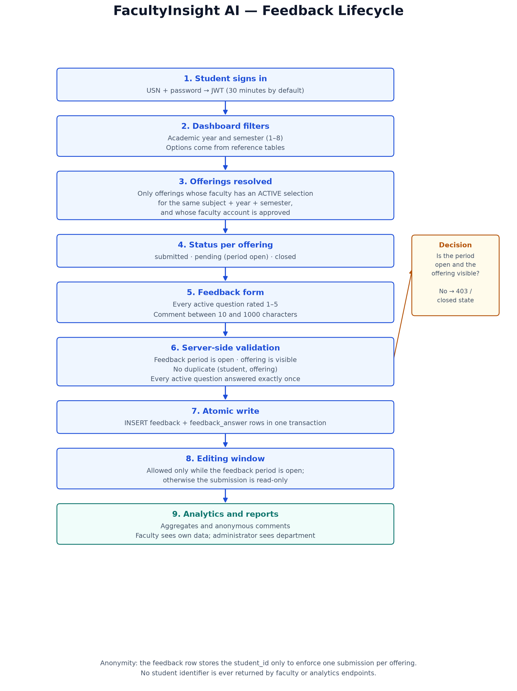

# 09 — Student Guide

> **FacultyInsight AI** · Documentation set · [Back to index](../README.md#documentation-index)

This guide walks a student through registration, submitting feedback and understanding what happens next.

## 9.1 Before you start

You need:

- your **USN** (for example `1RV21CS001`);
- your name as recorded by the department;
- a password of at least 8 characters containing a letter and a number.

Your department must already exist in the catalog. The registration form loads departments from the public endpoint.

## 9.2 Register

1. Open the app and go to **`/register/student`** (the login page links to it).
2. Enter your USN, full name and department.
3. Choose a password and confirm it.
4. Submit.

If registration succeeds you are taken back to the login page with a success message. Accounts are active immediately; no approval is required for students.

Common errors:

| Message | Cause |
|---------|-------|
| `That USN is already registered.` | The student ID exists. Sign in or contact the administrator. |
| `Passwords do not match.` | The two password fields differ. |
| `Use at least 8 characters.` | Password too short. |
| `Include at least one letter.` / `Include at least one number.` | Password rule not met. |

## 9.3 Sign in

1. Go to **`/login`**.
2. Choose the **Student** tab.
3. Enter your USN and password.

After sign-in you land on **`/student`**.

If you see `Invalid credentials`, the USN or password is wrong. If you see an inactive-account message, contact the administrator.

## 9.4 The dashboard

The student dashboard shows the subject offerings available to you for a selected academic year and semester.

### Filters

- **Academic year** — for example `2025-26`.
- **Semester** — 1 through 8.

The dropdown options come from the catalog. Changing a filter reloads the offering list.

### Summary tiles

| Tile | Meaning |
|------|---------|
| Submitted | Offerings where you already submitted feedback |
| Pending | Offerings with an open period where you have not submitted |
| Closed | Offerings whose period is closed and you did not submit |

The API also returns a `total` count used internally.

### Offering status

| Status | What it means | What you can do |
|--------|---------------|-----------------|
| `pending` | The feedback period is open and you have not submitted | Open the form |
| `submitted` | You submitted and the period is still open | View or edit |
| `closed` | The period has ended | No action; the form is unavailable if you never submitted |

> An offering appears only if the faculty member has an **active teaching selection** for that exact subject, academic year and semester, **and** their account is approved. If a subject is missing, the faculty member has probably not selected it yet.

## 9.5 Submit feedback

1. Click **Give feedback** on a pending offering.
2. You are taken to **`/student/feedback/:offeringId`**.
3. Rate **every active question** from 1 to 5:

   | Rating | Label |
   |--------|-------|
   | 1 | Very poor |
   | 2 | Poor |
   | 3 | Average |
   | 4 | Good |
   | 5 | Excellent |

4. Write a comment between **10 and 1000 characters**.
5. Submit.

The form refuses to submit until every question has a rating and the comment meets the length rule.

### What the server checks

Even if the browser is bypassed, the API independently verifies:

- the offering is visible to you (active selection + approved faculty);
- the feedback period is open;
- all active questions are rated exactly once, 1–5;
- the comment length is valid;
- you have not already submitted for this offering.

## 9.6 Edit a submission

While the period is open, a submitted offering shows an **Edit** action. You can change ratings and the comment. The original `submitted_at` is kept and `updated_at` is set.

After the period closes the submission becomes read-only.

## 9.7 Anonymity — what faculty see

This is important and is enforced in code, not just policy:

- Your `student_id` is stored on the feedback row **only** to enforce one submission per offering.
- Faculty dashboards, comment lists, analytics and reports **never** return your student ID, USN or name.
- Faculty see aggregate ratings and the comment text.
- Administrators see aggregates and comments, not which student wrote a comment.

The only place your identity is linked to feedback is inside the database row itself, and it is not exposed by any endpoint.

## 9.8 Change your password

Use the account menu in the top-right corner → **Change password**. Enter your current password, then the new one.

## 9.9 Troubleshooting

| Problem | Likely cause | Fix |
|---------|--------------|-----|
| No offerings shown | Wrong year/semester, or faculty have not selected subjects | Try another filter; ask faculty to select the subject |
| Offering shows `closed` | The period ended | Contact the administrator if this is unexpected |
| Cannot submit | Period closed, or a required rating is missing | Check the form messages |
| `409` on submit | You already submitted for this offering | Open the existing submission and edit it |
| Signed out unexpectedly | Token expired (30 minutes) | Sign in again |

## 9.10 Related documents

- [13 — Feedback Lifecycle](./13-feedback-lifecycle.md)
- [15 — Security and Privacy](./15-security-and-privacy.md)
- [19 — Troubleshooting](./19-troubleshooting.md)

---

**Next:** [10 — Faculty Guide →](./10-faculty-guide.md)
