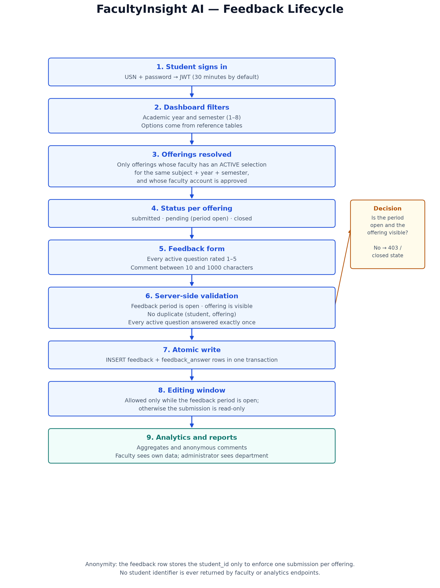

# 13 — Feedback Lifecycle

> **FacultyInsight AI** · Documentation set · [Back to index](../README.md#documentation-index)

This page follows a single feedback submission from the student's first click to the faculty dashboard.



*Figure 1 — The feedback lifecycle, including the server-side decision point.*

## 13.1 Lifecycle overview

| Stage | Actor | Where |
|-------|-------|-------|
| 1. Sign in | Student | `/login` |
| 2. Choose year + semester | Student | `/student` |
| 3. Offerings resolved | Server | `GET /api/students/me/dashboard` |
| 4. Open the form | Student | `/student/feedback/:offeringId` |
| 5. Rate + comment | Student | Form |
| 6. Validate + write | Server | `POST /api/students/me/feedback` |
| 7. Edit while open | Student | `PUT /api/students/me/feedback/{id}` |
| 8. Aggregate | Server | Analytics queries |
| 9. Review | Faculty / Admin | Dashboards, comments, reports |

## 13.2 Stage 1 — Authentication

The student signs in with USN and password. The server verifies the bcrypt hash and issues a JWT containing the student's ID and role. Every later request carries that token; the student's ID is never accepted from the request body.

## 13.3 Stage 2 — Filters

The dashboard offers academic year and semester. Options come from `academic_years` and `semesters`. The student's selection is passed as query parameters.

## 13.4 Stage 3 — Offerings resolved

The server returns only offerings that satisfy the visibility rule:

- the offering exists for the selected year and semester;
- the faculty member has an **active** selection for the same subject, year and semester;
- the faculty account is **approved**.

For each offering the server computes a status:

| Status | Condition |
|--------|-----------|
| `submitted` | A feedback row exists for this student and offering |
| `pending` | No feedback row, and the period is open |
| `closed` | No feedback row, and the period is closed or missing |

The period is looked up in `feedback_periods` by `(academic_year, semester_number)` and is open when `start_date <= now <= end_date`.

## 13.5 Stage 4 — Form

`GET /api/students/me/feedback/{offering_id}` returns:

- the offering details (subject, faculty name, dates);
- `period_open`;
- all **active** questions;
- the student's existing feedback, if any.

If the offering is not visible to the student, the endpoint returns `404`. If the period is closed and the student has no submission, it returns `403`. If the period is closed but a submission exists, the form is returned read-only (`editable: false`).

## 13.6 Stage 5 — Submission payload

```json
{
  "offering_id": 12,
  "ratings": [
    { "question_id": 1, "rating": 5 },
    { "question_id": 2, "rating": 4 },
    { "question_id": 3, "rating": 4 },
    { "question_id": 4, "rating": 5 },
    { "question_id": 5, "rating": 4 }
  ],
  "comment": "Clear explanations and useful lab examples throughout the semester."
}
```

Note there is **no `student_id`** field. It is derived from the token.

## 13.7 Stage 6 — Server-side validation

The API checks, in order:

1. **Visibility** — the offering is reachable for this student.
2. **Period** — the feedback period is open.
3. **Duplicates** — no existing `(student_id, offering_id)` row.
4. **Question coverage** — every active question is rated exactly once.
5. **Rating range** — each rating is 1–5.
6. **Comment length** — 10 to 1000 characters.

Failures map to:

| Condition | Status |
|-----------|--------|
| Offering not visible | `404` |
| Period closed | `403` |
| Already submitted | `409` |
| Missing/extra question | `422` |
| Rating out of range | `422` |
| Comment too short/long | `422` |

## 13.8 Stage 7 — Atomic write

Within one transaction the server inserts:

1. one row in `feedback` (student, offering, comment, timestamps);
2. one row in `feedback_answer` per question.

If any insert fails, the transaction rolls back, so a submission is never half-written.

A successful submission returns `201` with the created feedback ID and timestamps.

## 13.9 Stage 8 — Editing

While the period is open:

- the student can open the submission and change ratings or the comment;
- `PUT /api/students/me/feedback/{feedback_id}` replaces the answers and comment;
- `submitted_at` is preserved and `updated_at` is set.

Once the period closes, edits are refused. The original submission remains readable.

## 13.10 Stage 9 — Aggregation and review

Faculty and administrators never read raw `feedback.student_id`. Aggregation queries compute:

- response counts;
- average ratings overall and per question;
- rating distributions;
- trends across academic years;
- comment sentiment and themes.

The faculty dashboard is scoped to the caller's `faculty_id`. The admin dashboard covers the department.

## 13.11 State diagram

```text
              period opens
   (none) ─────────────────► pending
      ▲                        │
      │                        │ submit
      │                        ▼
      │                    submitted ── edit while open ──► submitted
      │                        │
      │   period closes        │ period closes
      └──────── closed ◄───────┘
```

- `pending` → `submitted` on a successful `POST`.
- `submitted` stays `submitted`; edits do not create a new row.
- If the period closes without a submission, the offering shows `closed`.

## 13.12 Worked example

**Student Asha, semester 5, 2025-26**

1. Asha signs in.
2. She filters to `2025-26`, semester `5`.
3. The dashboard shows three offerings. Two are `pending`, one is `submitted`.
4. She opens the first pending offering and rates all five questions, adding a 60-character comment.
5. The server validates and writes one `feedback` row plus five `feedback_answer` rows.
6. The offering now shows `submitted`.
7. She edits her comment the next day; `updated_at` changes.
8. The period closes; the form becomes read-only.
9. Her faculty member sees the ratings and the comment text, but not her name.

## 13.13 Why feedback is trustworthy

- **One per offering.** The unique constraint makes ballot stuffing impossible without multiple accounts.
- **Server-enforced rules.** Bypassing the UI does not bypass validation.
- **Immutable after close.** Historical reports cannot be altered by students.
- **Anonymity by query design.** Student identifiers are never selected by reporting queries.
- **Audit trail.** Administrative actions are logged.

## 13.14 Related documents

- [09 — Student Guide](./09-student-guide.md)
- [12 — Subject Selection and Requests](./12-subject-selection-and-requests.md)
- [14 — Analytics and AI](./14-analytics-and-ai.md)
- [15 — Security and Privacy](./15-security-and-privacy.md)

---

**Next:** [14 — Analytics and AI →](./14-analytics-and-ai.md)
